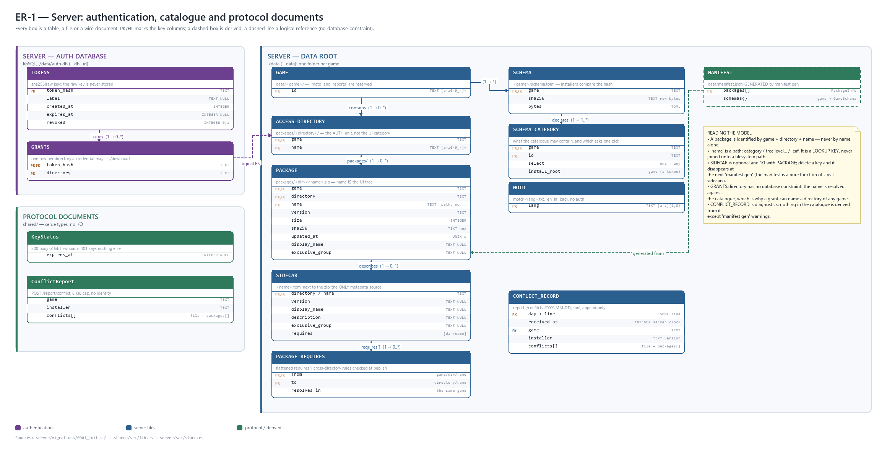
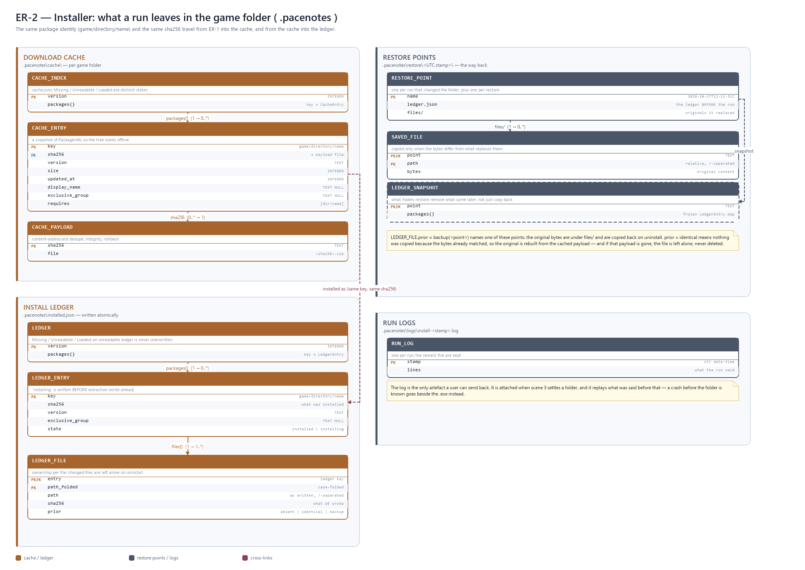
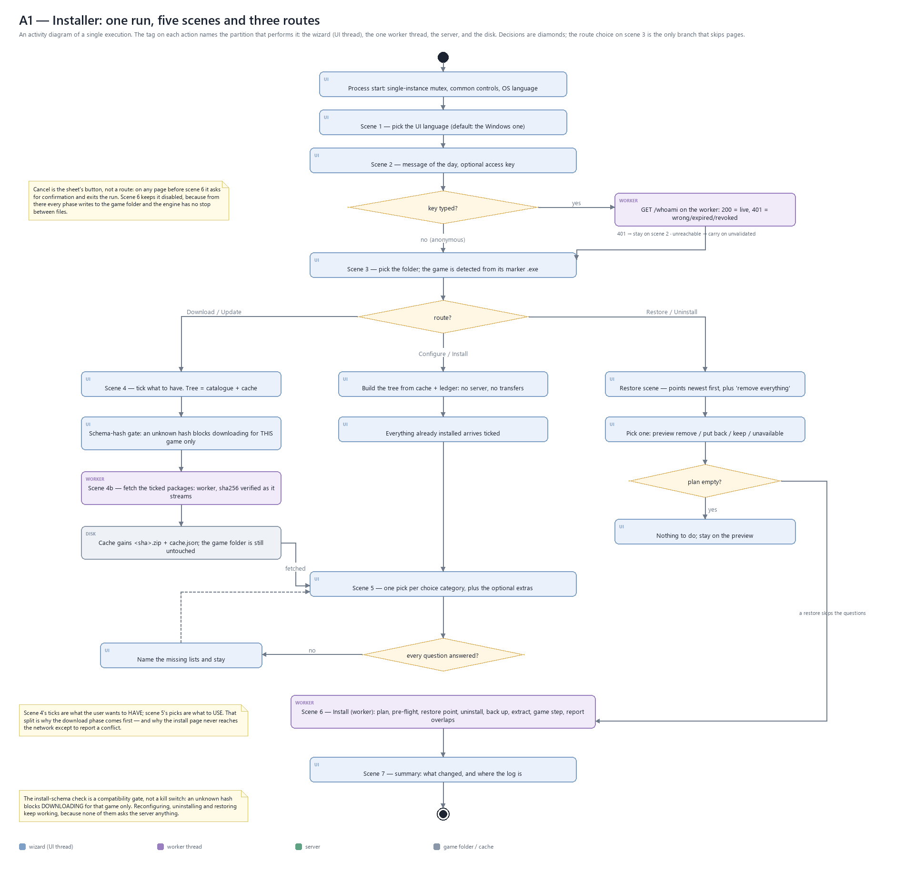
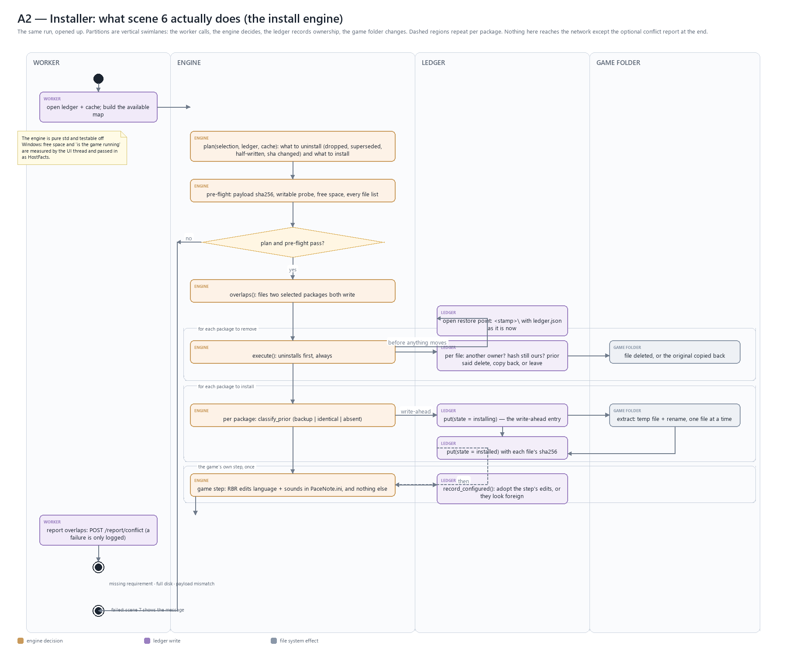
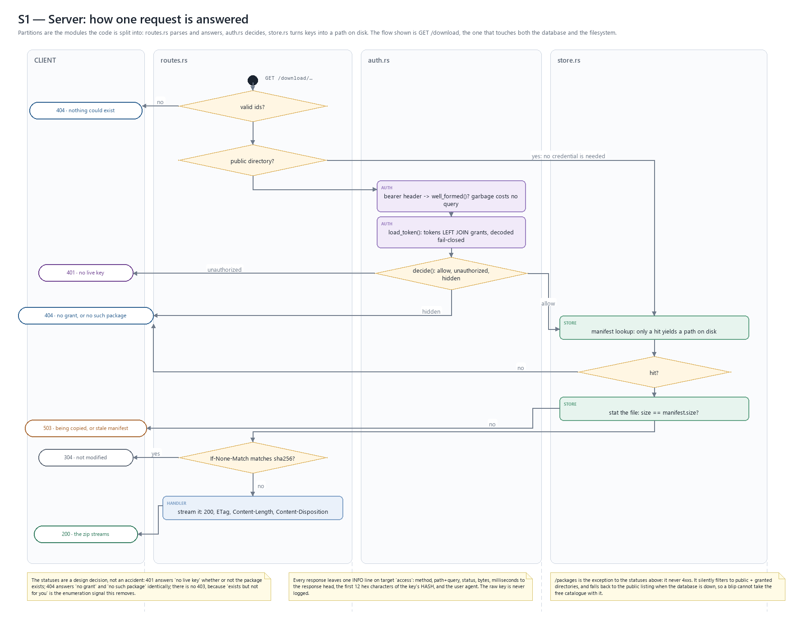
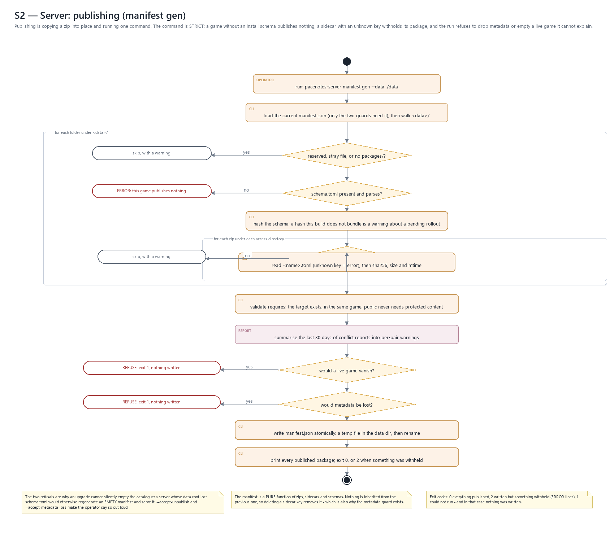
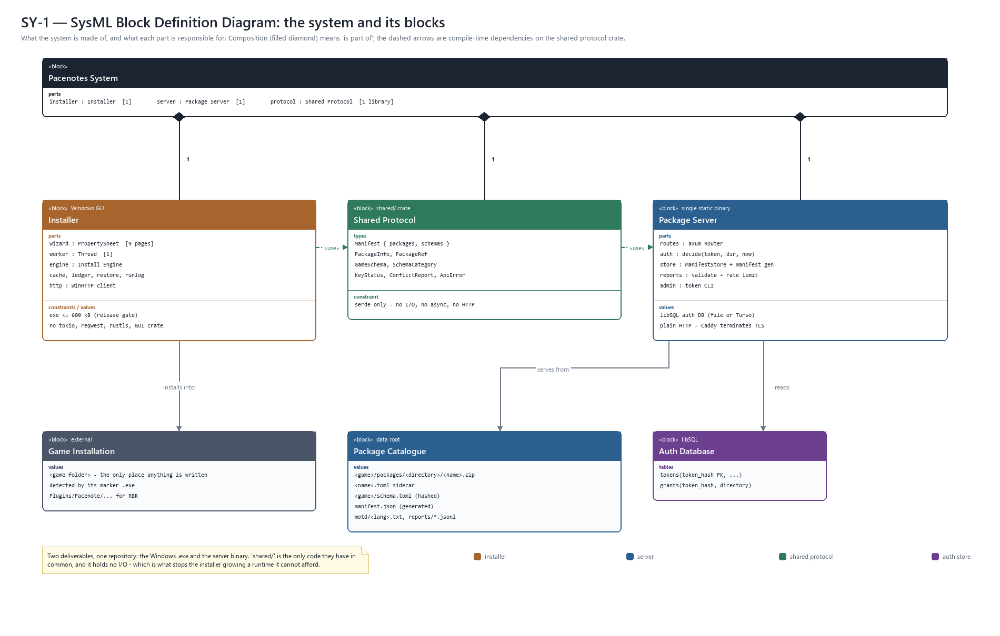
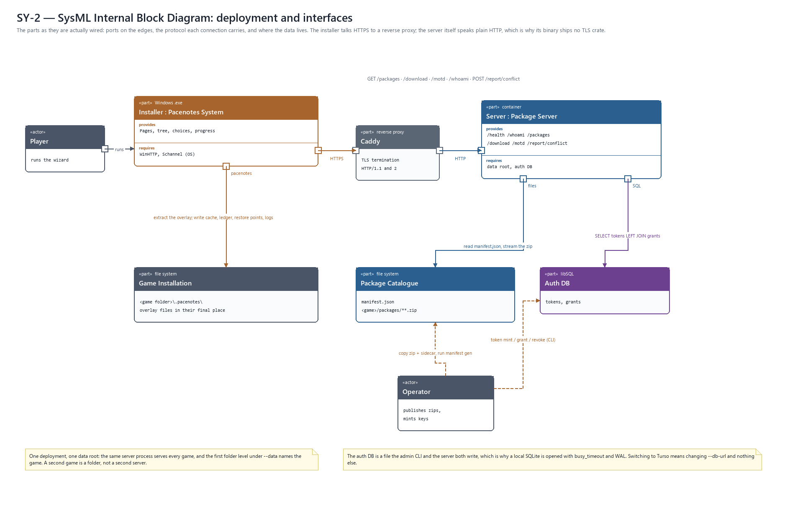
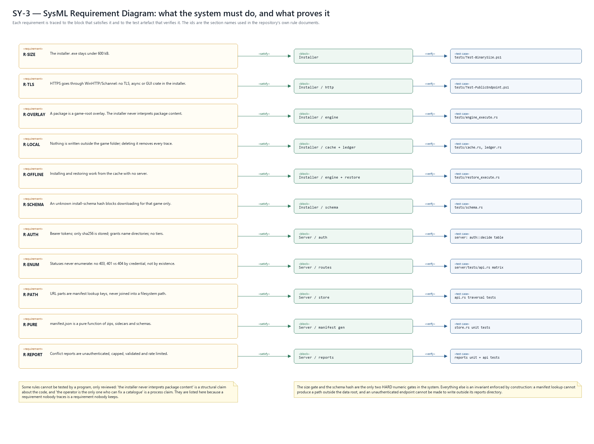

# Architecture diagrams

Nine diagrams of the Pacenotes system: an entity–relationship model, UML
activity diagrams for the installer and for the server, and SysML block,
internal-block and requirement diagrams.

They were drawn by reading the code, not by reading a design document: every
box, column and status below can be traced to a file named in
[Code map](#code-map). Where a rule is documented in `CLAUDE.md` it is marked
as such, because a diagram that quietly disagrees with the rule document is
worse than no diagram.

---

## Contents

| File | Notation | Answers |
|---|---|---|
| [er-server.png](er-server.png) | ER (UML-style) | What the server stores, and how a credential binds to a package directory |
| [er-installer.png](er-installer.png) | ER (UML-style) | What one run leaves inside `<game folder>\.pacenotes` |
| [activity-installer.png](activity-installer.png) | UML activity | One run end to end: five scenes, three routes |
| [activity-engine.png](activity-engine.png) | UML activity, partitions | What scene 6 does inside the engine |
| [activity-server.png](activity-server.png) | UML activity, partitions | How one HTTP request is answered, and where the access decision sits |
| [activity-manifest-gen.png](activity-manifest-gen.png) | UML activity | Publishing: what `manifest gen` refuses to do |
| [sysml-bdd.png](sysml-bdd.png) | SysML BDD | The blocks, their parts, and their constraints |
| [sysml-ibd.png](sysml-ibd.png) | SysML IBD | Deployment: parts, ports, protocols, data stores |
| [sysml-requirements.png](sysml-requirements.png) | SysML requirement | Each requirement, the block that satisfies it, the test that verifies it |

### Regenerating

    python docs/architecture/src/build_all.py

Python 3 and Pillow only — no graphviz, no mermaid, no browser. The layout is
explicit coordinates in `src/`, so the output is byte-stable and reviewable in
a diff. Regenerate after any structural change (a new endpoint, module, page
or stored field); the pictures are not generated at build time and will not
notice on their own.

---

## 1. The entity–relationship model

There are **two** ER diagrams because the system deliberately has **two
stores that never share a database**: the server's data root and auth DB, and
the installer's state inside the game folder. Nothing is replicated between
them except one identity and one hash.

### 1.1 The identity that travels

| Concept | Where it lives | Built by |
|---|---|---|
| `game / directory / name` | server manifest, cache index, ledger, download URL | `PackageInfo::download_path()` |
| `sha256` of the zip | server manifest, cache payload file name, ledger entry | `manifest gen`, verified by the installer |
| case-folded path | ledger file keys only | `ledger::fold()` |

`name` is a *path* under the access directory — `codriver/polish/male/Kamil` —
and its segments **are** the UI tree: category, then levels, then the leaf.
It is a lookup key and never joined onto a filesystem path; `shared::valid_name`
is the single choke point on both sides.

### 1.2 ER-1: server

**Authentication** (libSQL, `./data/auth.db`)

| Entity | Key | Notes |
|---|---|---|
| `TOKENS` | `token_hash` PK | sha256 of the raw key; `expires_at` NULL = never; `revoked` 0/1 |
| `GRANTS` | (`token_hash`, `directory`) PK | one row per directory; `public` is never granted |

`GRANTS.directory` is a **logical** foreign key: it names a directory in the
catalogue, and no database constraint can check it because the catalogue is
files on disk. That is a design choice, not an omission — the server resolves
the name by manifest lookup on every request, which is also what makes a
traversal impossible.

**Catalogue** (`./data`)

| Entity | Key | Notes |
|---|---|---|
| `GAME` | `id` PK | folder name; `motd` and `reports` are reserved, never games |
| `ACCESS_DIRECTORY` | (`game`, `name`) PK | `packages/<directory>/` — the auth unit, *not* the UI category |
| `PACKAGE` | (`game`, `directory`, `name`) PK | name is the path under the directory; version, size, sha256, updated_at, optional display_name / description / exclusive_group |
| `SIDECAR` | same key | `<name>.toml` next to the zip; the **only** source of that metadata |
| `PACKAGE_REQUIRES` | (`from`, `to`) PK | flattened `requires[]`; resolved within one game only |
| `SCHEMA` | `game` PK | `<game>/schema.toml`, hashed over its **raw bytes** |
| `SCHEMA_CATEGORY` | (`game`, `id`) PK | `select` one/any, `install_root` a token, never a path |
| `MOTD` | `lang` PK | `motd/<lang>.txt`, `en` fallback, no auth |
| `CONFLICT_RECORD` | day + line | append-only JSONL; diagnostics, never input to the catalogue |
| `MANIFEST` (derived) | — | `data/manifest.json`, generated from the rows above |

**Protocol documents** are shown as entities too, because they are what
crosses the wire and what the installer parses: `Manifest`,
`GameSchema`/`SchemaCategory`, `PackageInfo`, `KeyStatus`, `ConflictReport`,
`ApiError` — one module each in `shared/src/`, serde only.

### 1.3 ER-2: installer

| Entity | Key | Notes |
|---|---|---|
| `CACHE_INDEX` | — | `cache.json`; Missing / Unreadable / Loaded are three distinct states |
| `CACHE_ENTRY` | `game/directory/name` | a snapshot of `PackageInfo`, so the tree works offline |
| `CACHE_PAYLOAD` | `sha256` | `<sha256>.zip`; content addressing gives dedupe, integrity and rollback |
| `LEDGER` | — | `installed.json`, written atomically (temp + rename) |
| `LEDGER_ENTRY` | `game/directory/name` | `state` is `installed` or `installing` (write-ahead) |
| `LEDGER_FILE` | (`entry`, `path_folded`) | the path as written, the hash **we** wrote, and `prior` |
| `RESTORE_POINT` | UTC stamp | `restore/<stamp>/` with `ledger.json` and `files/` |
| `SAVED_FILE` | (`point`, `path`) | the original bytes, copied only when they differ |
| `LEDGER_SNAPSHOT` | (`point`) | the ledger **before** the run — what makes restore also remove later work |
| `RUN_LOG` | stamp | `logs/install-<stamp>.log`, one per run, newest five kept |

Two columns matter more than the rest:

* **`prior`** — `absent`, `identical` or `backup`. It is what tells a later
  uninstall whether to delete the file, rebuild it from the cached payload, or
  copy the saved original back. Without it, the byte-identical optimisation
  would silently turn a file the user already had into a file the installer
  owns and later deletes.
* **`state: installing`** — written *before* extraction, so a run that dies
  halfway leaves files the next run can recognise as its own instead of
  treating them as the pristine originals and backing them up.

### 1.4 How the two diagrams meet

    server PACKAGE ──download──▶ CACHE_ENTRY ──install──▶ LEDGER_ENTRY
      (game, dir, name)            (same key)               (same key)
      sha256 ──────────────────▶ CACHE_PAYLOAD ───────────▶ PER-FILE sha256

A package is fetched once per game folder and installed from the cache, which
is why installing and restoring work with the server unreachable.

---

## 2. UML activity — the installer

### 2.1 The run

| Scene | Page | What it decides | Source |
|---|---|---|---|
| 1 | `IDD_S1_LANGUAGE` | UI language; defaults to the Windows one | `wizard/scene/language.rs` |
| 2 | `IDD_S2_MOTD` | message of the day, optional access key | `wizard/scene/message_of_the_day.rs`, `api/` |
| 3 | `IDD_S3_FOLDER` | the game folder, and which game it is (marker `.exe`) | `wizard/scene/game_folder.rs`, `gamedir/` |
| 4 | `IDD_S4_DOWNLOAD` | what to have on this computer (tree from catalogue + cache) | `wizard/scene/download.rs`, `tree/` |
| 4b | `IDD_S4B_FETCH` | the transfers; cache only, nothing is installed | `wizard/scene/fetching.rs`, `worker/download_run.rs` |
| 5 | `IDD_S5_CONFIG` | one pick per choice category, plus the optional extras | `wizard/scene/configuration.rs`, `choices/`, `schema.rs` |
| 6 | `IDD_S6_INSTALL` | the run itself | `wizard/scene/installation.rs`, `engine/` |
| 7 | `IDD_S7_SUMMARY` | what changed, where the log is | `wizard/scene/summary.rs` |
| — | `IDD_RESTORE` | restore points: preview, then carry out | `wizard/scene/restore.rs`, `restore/` |

**Three routes**, which part at scene 3 and never fork again:

| Route | Path | Reaches the network? |
|---|---|---|
| Download / Update | 4 → 4b → 5 → 6 → 7 | yes: catalogue and downloads |
| Configure / Install | 5 → 6 → 7 | no |
| Restore / Uninstall | restore → 6 → 7 | no |

That split is why there is no separate "offline mode": Configure *is* the
Download route with the two transfer pages left out.

Two decisions on the diagram are worth reading twice:

* **Scene 4's ticks are what the user wants to HAVE; scene 5's picks are what
  to USE.** Downloading therefore happens before the questions, and the install
  page can work from the cache alone.
* **The schema-hash check blocks downloading, and only for that game.** An
  outdated installer may still reconfigure, uninstall and restore what is
  already on the machine — taking a working setup away from a user because they
  did not update would be the worst possible answer.

Cancel is the sheet's button, not a route: it is honoured on every page before
scene 6 and disabled there, because from that point every phase writes to the
game folder and the engine has no stop between files.

### 2.2 Scene 6 — the engine

The order is the safety argument, not a style:

1. **Plan** what to uninstall (dropped, superseded by a pick or an
   `exclusive_group`, half-written, or sha changed) and what to install.
   Dependencies are checked against the **selection**, not the ledger: anything
   installed and unselected is removed a few lines later.
2. **Pre-flight** everything that can fail — payload hash, write probe, free
   space, every file list — while the folder is still untouched.
3. **Open the restore point** holding the ledger as it is now.
4. **Uninstall first, always.** All three style packages ship the same 49
   paths, so installing before uninstalling would delete what was just written.
5. Per package: classify each file's `prior`, write the ledger entry as
   `installing`, extract atomically, then mark `installed` with each file's
   hash.
6. Run the game's **own** configuration step, then re-adopt the hashes of the
   files it edited — otherwise the next uninstall would read our own edit as
   somebody else's and leave the file behind.
7. Report overlapping files to the server; a failed report is a log line.

The engine is pure `std` and has to stay testable off Windows, so the two facts
it cannot measure — free space and "is the game running" — are passed in by the
UI thread as `HostFacts`.

---

## 3. UML activity — the server

### 3.1 One download request

The whole access model is one table:

| Situation | Answer |
|---|---|
| `public` directory | the package, or 404 |
| protected directory, no live key | **401**, whether or not the package exists |
| protected directory, live key without the grant | **404**, identical to "no such package" |
| protected directory, live key with the grant | the package, or 404 |

There is no 403: "exists, but not for you" is the enumeration signal this
avoids. `/packages` is the exception that proves the rule — it never 4xxs, it
silently filters to the public + granted directories and falls back to the
public listing when the database is down.

The URL parts (`game`, `directory`, `name`) are **manifest lookup keys**, never
path fragments; only a manifest hit yields `data/<game>/packages/<directory>/<name>.zip`.
That is what structurally prevents traversal, and what makes the wildcard
`{*name}` safe.

Two smaller decisions the diagram shows: an `Authorization` value that cannot
be a minted key is rejected before any query (garbage stays cheap), and a file
whose size disagrees with the manifest is refused with 503 rather than streamed
— the client would fail its own sha256 check anyway.

### 3.2 Publishing

Publishing is copying a zip into place and running one command. The command is
strict on purpose:

* no `schema.toml` → the game publishes **nothing** (error, not a warning);
* a package in a category the schema does not declare → skipped with a warning;
* a sidecar with an unknown key → **that package** is withheld (the rest still
  publishes), and the run exits 2;
* metadata the current manifest carries would disappear → refuse, exit 1,
  nothing written, unless `--accept-metadata-loss`;
* a game that is live now would vanish because its schema is missing → refuse,
  exit 1, unless `--accept-unpublish`.

The manifest is a **pure function** of zips, sidecars and schemas: nothing is
inherited from the previous one, so deleting a sidecar key removes it at the next
publish. The two guards exist because that purity is also what makes an
accidental upgrade able to empty a live catalogue.

`manifest gen` also reads the last 30 days of conflict reports and turns them
into per-pair warnings — a user's bad day becomes something the operator can
fix in the catalogue.

---

## 4. SysML

### 4.1 Blocks

| Block | Responsibility | Constraint |
|---|---|---|
| **Installer** | the Windows GUI: nine pages, one worker thread, the install engine | `.exe < 600 kB`; no tokio, reqwest, rustls, hyper, GUI crate |
| **Package Server** | catalogue, auth, downloads, conflict reports, admin CLI | one static binary; TLS is Caddy's job, not its own |
| **Shared Protocol** | the wire types both sides compile against | serde only — no I/O, no async, no HTTP |
| **Package Catalogue** | zips, sidecars, schemas, the generated manifest, MOTD, reports | one folder per game under `--data` |
| **Auth Database** | tokens and their grants | libSQL; raw keys are never stored |
| **Game Installation** | the game folder this run targets | the only place anything is written |

The composition is deliberate: `shared/` is the *only* code the two binaries
have in common, and it holds no behaviour that could grow a runtime the
installer cannot afford.

### 4.2 Interfaces

| From | Port | To | Carries |
|---|---|---|---|
| Player | UI | Installer | choices only; the one thing sent is an anonymous conflict report |
| Installer | HTTPS | Caddy | `GET /packages`, `/download/...`, `/motd`, `/whoami`, `POST /report/conflict` |
| Caddy | `:8080` | Server | plain HTTP; TLS terminates at the proxy |
| Server | files | Catalogue | `manifest.json` and the zip streams |
| Server | SQL | Auth DB | `SELECT ... FROM tokens LEFT JOIN grants` |
| Installer | `.pacenotes` | Game Installation | the extracted overlay, cache, ledger, restore points, logs |
| Operator | CLI | Catalogue / Auth DB | copy a zip + sidecar, `manifest gen`, `token mint/grant/revoke` |

The installer's HTTPS is WinHTTP, so the TLS handshake is Schannel's — that is
why the binary ships no TLS crate, and why the server can speak plain HTTP on a
private network.

### 4.3 Requirements

| Id | Requirement | Satisfied by | Verified by |
|---|---|---|---|
| R-SIZE | `.exe < 600 kB` | Installer | `installer/tests/Test-BinarySize.ps1` |
| R-TLS | HTTPS via WinHTTP/Schannel; no TLS, async or GUI crate | Installer / http | `installer/tests/Test-PublicEndpoint.ps1` |
| R-OVERLAY | a package is a game-root overlay; content is never interpreted | Installer / engine | `installer/tests/applying_a_selection.rs` |
| R-LOCAL | nothing is written outside the game folder | Installer / cache + ledger | `installer/src/cache/tests.rs`, `installer/src/ledger/tests.rs` |
| R-OFFLINE | install and restore work from the cache | Installer / engine + restore | `installer/tests/restoring_a_game_folder.rs` |
| R-SCHEMA | an unknown schema hash blocks downloading for that game only | Installer / schema | `installer/src/schema/tests.rs` |
| R-AUTH | bearer tokens, sha256 stored, grants per directory, no tiers | Server / auth | `auth::decide` table test (`server/src/auth/access_decision.rs`) |
| R-ENUM | statuses never enumerate; no 403 | Server / routes | `server/tests/access_matrix.rs` |
| R-PATH | URL parts are lookup keys, never paths | Server / store | traversal tests |
| R-PURE | the manifest is a pure function of zips + sidecars + schemas | Server / manifest gen | `server/src/store/` unit tests |
| R-REPORT | unauthenticated, capped, validated, rate-limited reports | Server / reports | `reports` unit + API tests |

---

## 5. Notation

| Element | Means |
|---|---|
| Solid arrow | control flow / association |
| Dashed arrow | derived, logical reference (no database constraint), or compile-time dependency — the caption says which |
| Filled diamond | composition; the whole owns the part |
| Diamond | a decision, with the guards on the outgoing edges |
| Rounded pill | a terminator: the HTTP answer, or a refusal that writes nothing |
| Tag on an action (`UI`, `WORKER`, `SERVER`) | the partition that performs it |
| Vertical lane | the same, as a swimlane, where the flow is linear enough for one |
| Dashed rectangle labelled "for each …" | an expansion region: the actions inside repeat |

Colours carry no meaning on their own; every diagram also labels what it
colours (a participant tag, a zone title, a stereotype).

---

## 6. Code map

| Concern | Files |
|---|---|
| Protocol types | `shared/src/` |
| Wizard, pages, routes | `installer/src/wizard/`, `installer/res/installer.rc` |
| Tree and choices models | `installer/src/tree/`, `installer/src/choices/` |
| Worker thread, messages | `installer/src/worker/` |
| Plan / pre-flight / execute | `installer/src/engine/` |
| Restore points | `installer/src/restore/`, `installer/src/ledger/` |
| Cache | `installer/src/cache/`, `installer/src/api/` |
| HTTP | `installer/src/http/` (WinHTTP) |
| Game detection | `installer/src/gamedir/` |
| Install schema | `schemas/rbr.toml`, `installer/src/schema.rs`, `installer/build.rs` |
| Game-specific step | `installer/src/install/` |
| Router and handlers | `server/src/routes.rs` |
| Access decision | `server/src/auth/` |
| Catalogue and publishing | `server/src/store/` |
| Conflict reports | `server/src/reports/` |
| Credential CLI | `server/src/admin.rs` |
| Schema and migrations | `server/migrations/0001_init.sql`, `server/src/db.rs` |
| Deployment | `deploy/Containerfile`, `deploy/Caddyfile.snippet`, `deploy/pacenotes.container` |

---

## 7. What these diagrams deliberately do not show

* **No sequence diagrams.** The interesting ordering is inside one thread (the
  engine) or inside one request (the access decision); an activity diagram
  shows both without inventing lifelines.
* **No state machine.** The wizard is a property sheet with three routes, not a
  stateful protocol; the ledger's `installing → installed` is the only real
  state, and it is on ER-2.
* **No class diagram.** `shared/src/lib.rs` is a handful of structs; ER-1 and
  ER-2 already show them with the keys that matter.
* **No deployment topology beyond SY-2.** The quadlet, the container and the
  Caddy block are one host; a second diagram would repeat SY-2 with hostnames.
* **No timing, no performance.** The only numeric constraints are the 600 kB
  gate and the rate limits, and both are stated as requirements.
